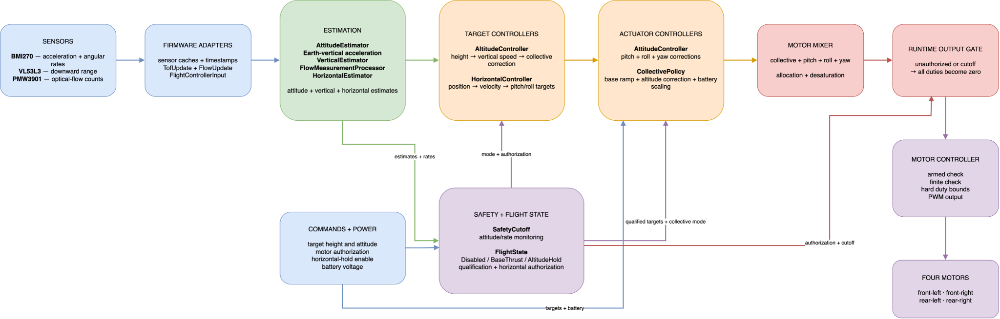

# stampfly-rust

Rust flight-control firmware for the M5Stamp Fly / ESP32-S3.

The firmware runs a 400 Hz control loop using the BMI270 IMU, downward
VL53L3 ToF sensor, and PMW3901 optical-flow sensor. 
`flight-core` crate provides attitude, altitude, and horizontal estimation and
control, safety-state coordination, collective policy, and motor mixing.

Flight traces are stored on the device and can be dumped over USB for offline
analysis.

## Architecture



## Safety

This is experimental flight software, not certified flight-control software.
Remove propellers for bench testing and use physical containment and an
emergency-disarm plan for flight tests.

Params and their values are the output of 250 runs of tweaking just to find the correct value. If you want to run this code yourself, consider tweaking them yourself. Some of them are dependent on the type of floor the drone flies above.


## Equipment used

[M5Stack Stamp Fly](https://docs.m5stack.com/en/app/Stamp%20Fly)

[BETAFPV LAVA 1S 300mAh 75C batteries](https://betafpv.com/products/lava-1s-300mah-75c-battery-5pcs)

## Commands

Run the host tests (tested on MacBook M4):

```sh
cargo test --manifest-path crates/flight-core/Cargo.toml --target aarch64-apple-darwin
```

Check the complete repository and formatting:

```sh
cargo check
cargo fmt --check
```

Build optimized firmware and flash it with the serial monitor:

```sh
cargo build --release
espflash flash --monitor target/xtensa-esp32s3-espidf/release/stampfly-rust
```

## Main components

- `crates/flight-core`: hardware-independent estimators, controllers, safety,
  state coordination, and motor allocation.
- `src/main.rs`: ESP32 hardware setup, the 400 Hz loop, motor output, and trace
  lifecycle.
